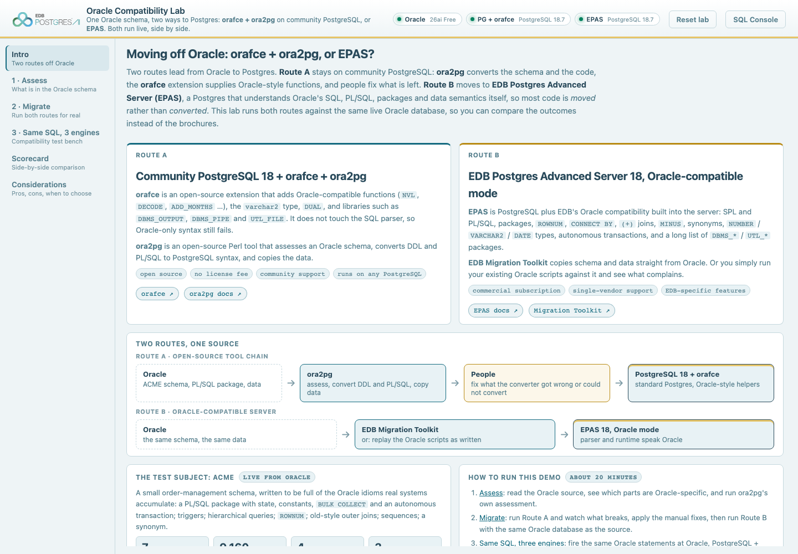
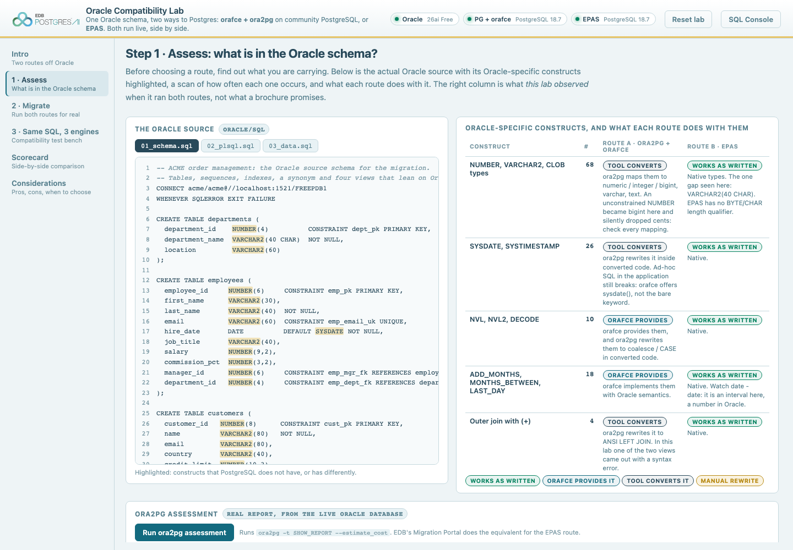
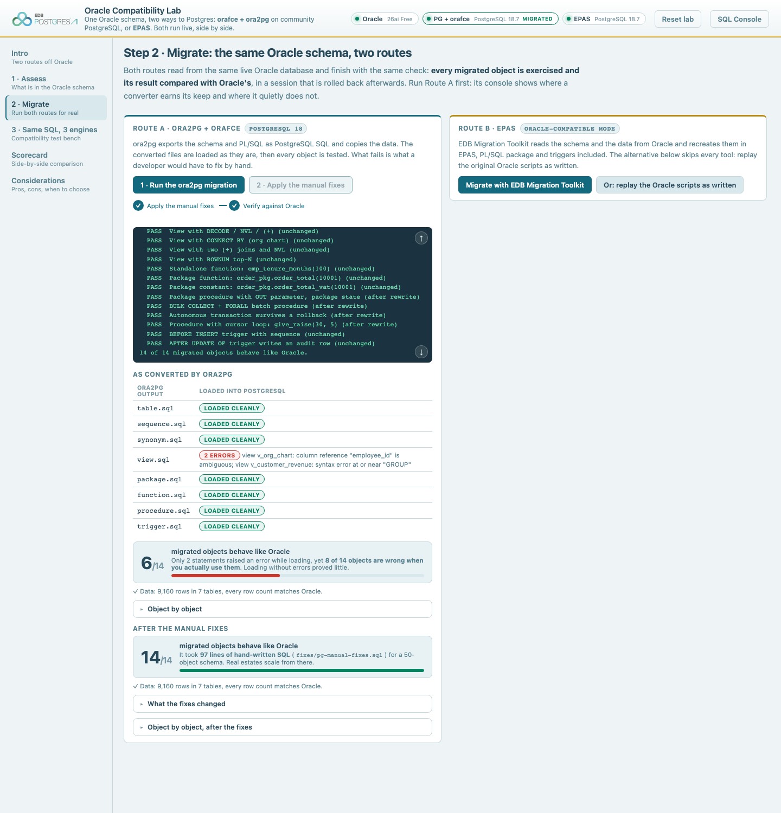
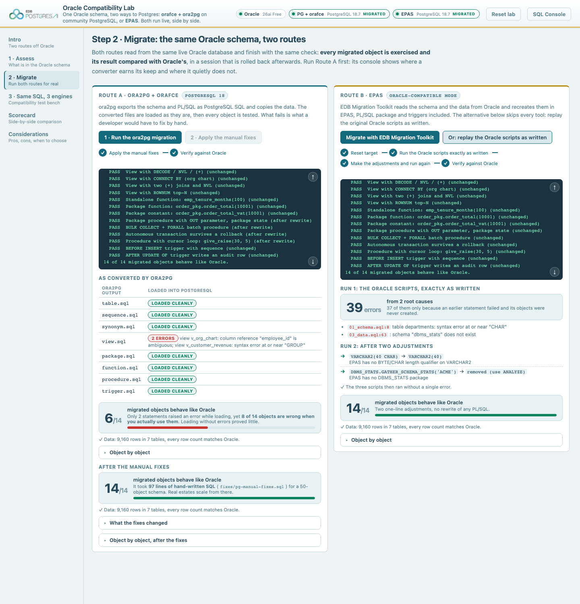
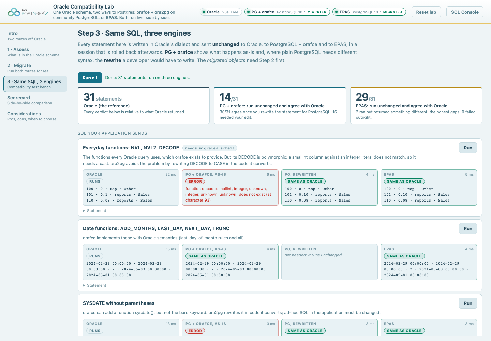
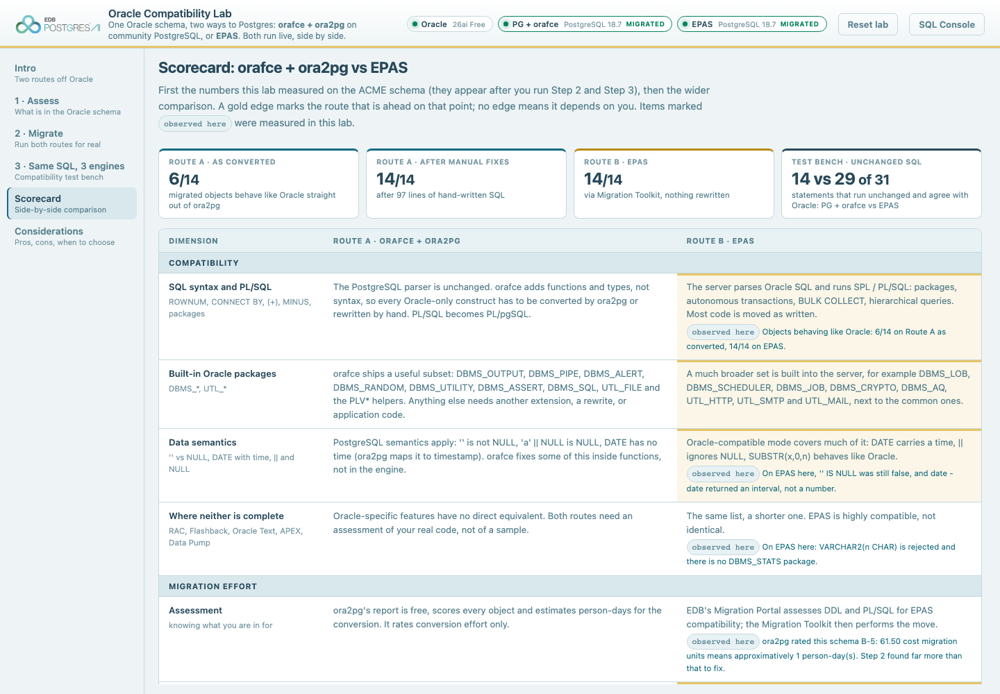
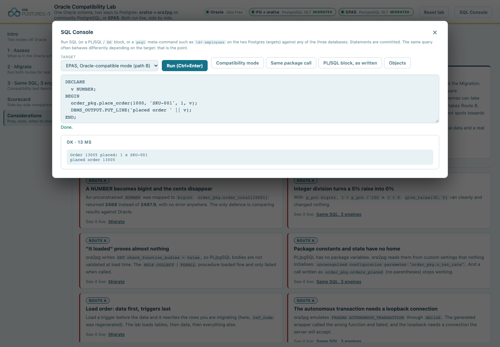
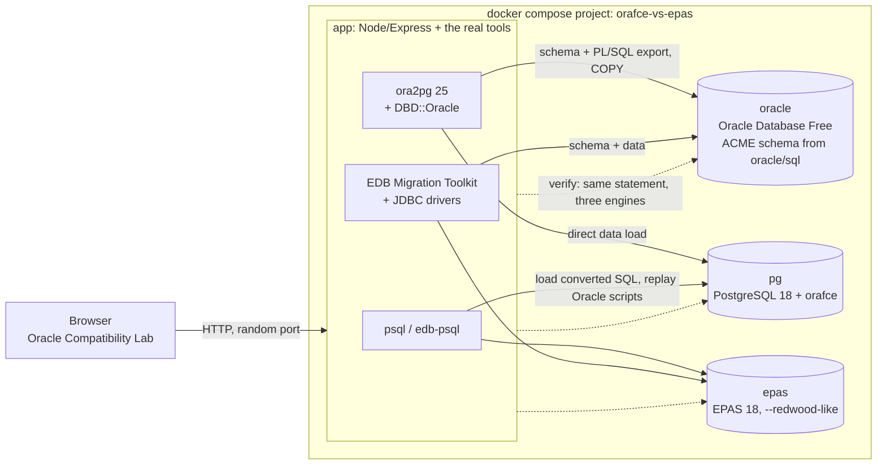
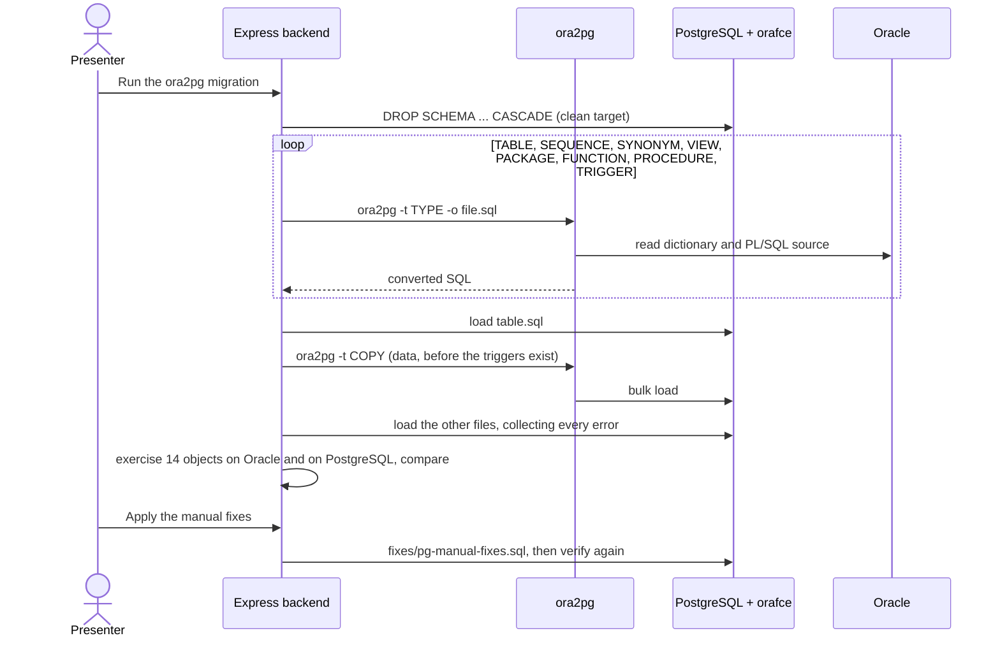

[](https://shields.io/)
[](https://GitHub.com/Naereen/StrapDown.js/graphs/commit-activity)

# Oracle Compatibility Lab: orafce + ora2pg vs EPAS

## Intro
Two routes lead from Oracle to Postgres, and they are often presented as if they were the same thing. They are not.

| | Route A: community PostgreSQL | Route B: EDB Postgres Advanced Server |
| --- | --- | --- |
| What you run | PostgreSQL 18 + the **orafce** extension | **EPAS 18**, initialised in Oracle-compatible mode (`--redwood-like`) |
| How the code gets there | **ora2pg** *converts* the schema and PL/SQL to PostgreSQL syntax; people fix the rest | The server parses Oracle SQL and runs PL/SQL itself, so code is *moved*. **EDB Migration Toolkit** copies schema and data, or you replay your Oracle scripts |
| What orafce / the server adds | Functions, `varchar2`, `DUAL`, `DBMS_OUTPUT` and friends. **No syntax**: `ROWNUM`, `CONNECT BY`, `(+)`, packages still fail | Parser and runtime support for the Oracle dialect, packages, autonomous transactions, many `DBMS_*` / `UTL_*` packages |
| Licence and support | Open source, no licence fee, community support | EDB subscription, single-vendor support |

This demo runs **both routes for real, against the same live Oracle database**, and then makes them prove themselves: every migrated object is *exercised* and its result compared with Oracle's. It is driven entirely through the web UI.

| | |
| --- | --- |
|  |  |
|  |  |
|  |  |

The app uses the EDB Blue Coal theme and has a built-in **SQL Console** that runs against all three databases (Oracle, PostgreSQL + orafce, EPAS), including PL/SQL blocks, `DO` blocks and `psql` meta-commands.



## Run it
```bash
./00-provision.sh
```
Then open the URL it prints (the web UI port is random, so several demos can run side by side).

The first start takes a while: the images are built (about 10 minutes, the EDB packages are large) and Oracle creates its database (about 4 minutes). Later starts are fast.

Tear it down with:
```bash
./99-deprovision.sh
```

## Demo flow (about 20 minutes)
1. **Intro**: the two routes, the ACME test schema (live inventory from Oracle), how the lab is wired.
2. **1 · Assess**: the real Oracle source with its Oracle-specific constructs highlighted; a scan of how often each occurs and what each route does with it; then **Run ora2pg assessment** for the real report (`ora2pg -t SHOW_REPORT --estimate_cost`).
3. **2 · Migrate**: run **Route A** and watch the console, then look at the result: *loading without errors proved little*. Click **Apply the manual fixes** and see what it took. Then run **Route B**: *Migrate with EDB Migration Toolkit*, and/or *replay the Oracle scripts as written*.
4. **3 · Same SQL, 3 engines**: **Run all** sends 31 Oracle-dialect statements, unchanged, to all three engines and scores each one against Oracle's own answer. Open the *Statement* fold on any row to see the Oracle SQL and the PostgreSQL rewrite.
5. **Scorecard** and **Considerations**: the numbers the lab measured next to the wider comparison, when to choose which, and the traps it fell into.

The **SQL Console** (top right) is the place to improvise: paste the same query into all three targets. **Reset lab** drops both migrated schemas so you can run it again.

## What the lab measured
On the ACME schema (7 tables, 4 views, 3 sequences, a PL/SQL package with 7 subprograms, 2 triggers, a function, a procedure, a synonym; 9,160 rows). Versions: Oracle AI Database 26ai Free 23.26, PostgreSQL 18.7 + orafce 4.17, ora2pg 25.0, EPAS 18.7, EDB Migration Toolkit 55.14.

| | Route A: ora2pg + orafce | Route B: EPAS |
| --- | --- | --- |
| Assessment | ora2pg report: **level B-5**, 61.5 cost units (about 1 person-day, by ora2pg's own estimate of the *conversion*) | EDB Migration Portal assesses for EPAS (not part of this lab) |
| Objects created without an error | 2 statements failed to load (both views) | Migration Toolkit: **40 of 40** objects |
| Migrated objects that behave like Oracle | **6 of 14** as converted | **14 of 14**, nothing rewritten |
| After the manual work | **14 of 14**, after **97 lines** of hand-written SQL (`fixes/pg-manual-fixes.sql`) | Replaying the Oracle scripts as written: 39 errors from **2 root causes**; after **2 one-line adjustments**, 0 errors and 14 of 14 |
| Data | 9,160 rows, every table count matches Oracle | same |
| 31 Oracle-dialect statements, sent unchanged | **14** agree with Oracle (30 once rewritten for PostgreSQL) | **29** agree; 2 run but differ |

Where **EPAS is not identical to Oracle**, the lab says so: `date - date` returns an interval where Oracle returns a number, `''` is not NULL, `VARCHAR2(n CHAR)` is rejected and there is no `DBMS_STATS`.

What went wrong on **Route A** is the more useful part, because most of it is silent. The Considerations tab has the full list; the headline ones:

* an unconstrained `NUMBER` became `bigint`, so `order_total(10001)` returned **2488** instead of **2487.9**, with no error;
* `1 + p_pct / 100` became integer division, so `give_raise(30, 5)` ran cleanly and gave a **0%** raise;
* ora2pg sets `check_function_bodies = false`, so broken PL/pgSQL (`BULK COLLECT` / `FORALL`) **loads fine** and only fails when called;
* package constants and package state became custom settings that nothing initialised;
* the autonomous-transaction wrapper called the wrong `dblink` function;
* two of four views came out of the converter with SQL that does not compile (`CONNECT BY`, `(+)`);
* orafce's `SUBSTR(x, 0, n)` only behaves like Oracle's when `oracle` comes before `pg_catalog` in the `search_path`.

A 50-object schema is a toy. Use it to understand the *kinds* of problem each route has, not to predict the size of your project. Performance, high availability, licence cost and your own application code are out of scope.

## How it works

### Architecture


Nothing is mocked. Every console on the Migrate tab streams the real output of the tool, and every verdict on the test bench is a real query on a real engine. The EDB subscription token is only used at build time, as a BuildKit secret, and is not stored in an image.

### Route A, step by step


Two choices keep the comparison fair: ora2pg runs with `USE_ORAFCE` and `PACKAGE_AS_SCHEMA` (so `order_pkg.order_total(...)` keeps its Oracle call syntax), and the orafce `search_path` convention is the one ora2pg itself emits, until the manual fixes change it to what orafce recommends.

### How "behaves like Oracle" is decided
Each of the 14 *migrated object* checks (and 17 *dialect* checks on the bench) is a short script in `app/presets.js`. The same script runs in one session on Oracle and on the target, inside a transaction that is rolled back afterwards, and the result sets are compared after normalising numbers and dates. Where plain PostgreSQL needs different syntax, the preset carries a `pgRewrite`, so the UI can show both the as-is outcome and the rewrite. Statements that PostgreSQL cannot run as written (PL/SQL blocks, `ROWNUM`) are therefore *expected* to fail as-is; what the lab measures is how many need your edit.

### Repository layout
| Path | What |
| --- | --- |
| `00-provision.sh`, `99-deprovision.sh` | start / stop the lab |
| `docker-compose.yml` | the four containers |
| `oracle/sql/` | the Oracle source: user, schema, PL/SQL, data. Loaded by the Oracle container at first start, and shown in the UI |
| `pg/` | PostgreSQL 18 + orafce image, init script |
| `epas/` | EPAS 18 image, `initdb --redwood-like` entrypoint |
| `app/` | web UI (`public/`), backend (`server.js`), engine access (`db.js`), the test set (`presets.js`), the construct scan (`features.js`), and the Dockerfile with ora2pg and Migration Toolkit |
| `fixes/pg-manual-fixes.sql` | the hand-written corrections applied to Route A |
| `screenshots/` | README images |

## Prerequisites
* Docker with Compose v2 and about 10 GB free for the images
* Your EDB subscription token in `~/.tokens/edb_subscription_token` (https://www.enterprisedb.com/accounts/profile). It is read at build time only.
* Internet access (EDB repository, Docker Hub, Oracle's container registry, Maven Central, GitHub, `download.oracle.com`)
* Oracle Database Free: `00-provision.sh` reuses `container-registry.oracle.com/database/free:latest` (or the `hrplus/oracle-database:23.26-free` image) if it is already on the machine, otherwise Docker pulls Oracle's. Set `ORACLE_IMAGE` to use another.

Built and tested on Apple Silicon (arm64). The x86 build path (Oracle Instant Client, Oracle image, EPAS packages) uses the architecture-specific downloads but has not been run.

## Troubleshooting
* **The Oracle chip stays red for minutes.** Normal on the very first start: Oracle is creating its database. Watch `docker compose logs -f oracle` for `DATABASE IS READY TO USE!`.
* **The build fails at the `dnf install` step.** The EDB repository was not reachable, usually because of the token. The repository script's output is silenced on purpose, so that the token never shows up in the build log.
* **A port is taken.** The script uses 5432, 5444 and 1521 when free and a random port otherwise; the UI port is always random.
* **Connect with your own tools.** The script prints the `psql` and `sqlplus` lines; the user and password are both `acme`.

## Stack
* Oracle AI Database 26ai Free, PostgreSQL 18 + orafce 4.17, EDB Postgres Advanced Server 18 (AlmaLinux 9)
* ora2pg 25.0 with DBD::Oracle and Oracle Instant Client; EDB Migration Toolkit 55 with the Oracle and EDB JDBC drivers
* Node.js 20 / Express, `pg` and `node-oracledb` (thin mode); no front-end framework
